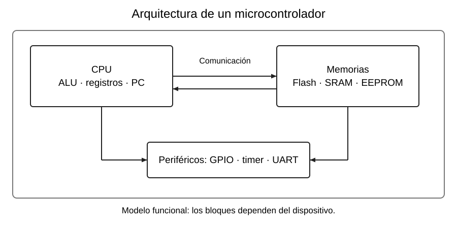

# Microcontroladores y sistemas embebidos

[Índice de la semana](README.md) · [Siguiente: CPU](02_Arquitectura_CPU.md)

## Qué es un microcontrolador

Un **microcontrolador** es un circuito integrado que reúne una CPU, memoria y periféricos. La CPU ejecuta el programa; las memorias conservan instrucciones y datos; los periféricos permiten interactuar con señales, medir tiempo y comunicarse.

En un termostato, por ejemplo, el programa lee un sensor, compara la temperatura con una consigna y decide si activa una salida. Esa salida controla una etapa adecuada para la carga. **Un motor o una resistencia de potencia no se alimentan directamente desde un GPIO**.

El dibujo es funcional: muestra responsabilidades, no la distribución física de un chip concreto. Los detalles de comunicación interna se estudian en [CPU y buses](02_Arquitectura_CPU.md).

## Microcontrolador frente a microprocesador

| Aspecto | Microcontrolador | Microprocesador, en la comparación de clase |
|---|---|---|
| Integración | CPU, memorias y periféricos en el mismo dispositivo | Procesamiento central con mayor dependencia de memoria y componentes externos |
| Uso habitual | Control de dispositivos y adquisición de señales | Cómputo general o aplicaciones de mayor capacidad |
| Recursos | Se eligen para las necesidades concretas de la tarea | Suelen permitir sistemas con más memoria y software complejo |
| Consumo y costo | A menudo reducidos para aplicaciones de control | Dependen de la plataforma y de sus prestaciones |
| Ejemplo del curso | ATmega328P; ESP32 | CPU de un computador personal |

**Precisión de alcance:** la distinción «microprocesador = solo CPU» es un modelo introductorio. Los dispositivos actuales pueden integrar cachés, controladores y muchos periféricos. Tampoco todo sistema embebido utiliza un microcontrolador: puede emplear un microprocesador, un SoC o lógica programable.

## Sistemas embebidos

Un **sistema embebido** integra cómputo dentro de un equipo para cumplir una función concreta. Una lavadora controla etapas de lavado; un router gestiona comunicaciones; un automóvil incorpora varios sistemas de control. Una función concreta puede incluir numerosas tareas relacionadas.

Trabajar en **tiempo real** significa cumplir plazos de respuesta. No equivale simplemente a ejecutar rápido: una respuesta correcta que llega demasiado tarde puede resultar inútil. No todos los sistemas embebidos tienen las mismas exigencias temporales.

## Cómo elegir un dispositivo

La elección debe partir de la aplicación: cantidad de entradas y salidas, memoria, comunicaciones, tiempo de respuesta, consumo, costo y herramientas. El ESP32 aporta conectividad; un AVR puede resolver un control sencillo con menos recursos. La mayor frecuencia no sustituye una buena elección de periféricos.

Las señales digitales se interpretan como bajo y alto dentro de **rangos de tensión**. En los ejemplos se comparan el Uno a 5 V y el ESP32 a 3,3 V, pero los umbrales exactos se consultan en la ficha técnica. Un 1 lógico no es una tensión universal.

## Comprobación

**¿Qué bloque permite que una CPU siga trabajando mientras transcurre un intervalo?** Un temporizador de hardware. La CPU lo configura y el periférico cuenta de forma autónoma.

**Base de clase:** R, pp. 2–3; K01; I11, pp. 1–2. Las claves se desarrollan en [Fuentes](../FUENTES.md).
