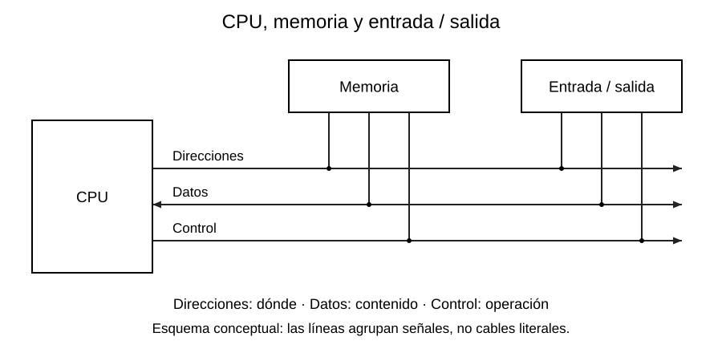
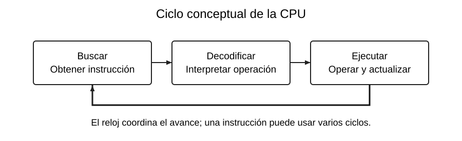

# CPU, buses, reloj y arquitecturas

[Índice de la semana](README.md) · [Siguiente: memorias](03_Memorias.md)

## Dentro de la CPU

La **CPU** interpreta las instrucciones y coordina las operaciones. La **ALU** (unidad aritmética y lógica) realiza sumas, restas, comparaciones y operaciones de bits. Los **registros de trabajo** mantienen operandos y resultados cercanos a la ALU; el AVR estudiado tiene 32 registros de ocho bits, `r0` a `r31`.

La **unidad de control** interpreta la instrucción y activa los caminos necesarios. El **contador de programa**, o PC, mantiene la dirección que guía la secuencia de instrucciones. Un salto cambia esa secuencia; por eso el programa no siempre recorre direcciones consecutivas.

Un **núcleo** es una unidad capaz de ejecutar instrucciones. Varios núcleos pueden avanzar en paralelo, aunque compartir memoria exige coordinación. La expresión `PC → unidad de control → ALU` ayuda a recordar funciones, pero no representa por sí sola todo el cableado interno.

## Los tres buses

Un bus agrupa señales de comunicación. En el modelo básico:

| Bus | Pregunta que responde | Ejemplo |
|---|---|---|
| Direcciones | ¿Dónde leer o escribir? | Dirección de datos `0x25` |
| Datos | ¿Qué contenido se transfiere? | Byte `0010 0000` |
| Control | ¿Qué operación y cuándo? | Lectura, escritura y habilitación |

Para escribir, la CPU presenta una dirección, el dato y las señales de escritura. Para leer, presenta la dirección y las señales de lectura; el destino entrega el dato. El bus de datos suele ser bidireccional. Las direcciones salen del maestro en este modelo y las señales de control pueden tener distintos sentidos.

Con $n$ bits de dirección se identifican $2^n$ posiciones. Diez bits permiten $2^{10}=1024$ posiciones. La capacidad en bytes depende de cuántos bytes contiene cada posición.

## Buscar, decodificar y ejecutar

1. **Búsqueda:** se obtiene la instrucción desde la memoria de programa.
2. **Decodificación:** se interpreta qué operación y operandos requiere.
3. **Ejecución:** se opera, se accede a memoria o se cambia el flujo.

El ciclo vuelve a comenzar. Esta división es conceptual: una implementación puede solapar fases mediante una tubería de ejecución. La FPGA mencionada en las fuentes es **hardware lógico configurable**, no un lenguaje ensamblador.

## Frecuencia y período del reloj

La frecuencia $f$ indica ciclos por segundo y el período $T$ indica segundos por ciclo:

$$
T=\frac{1}{f},\qquad f=\frac{1}{T}.
$$

**Datos:** $f=16\,\mathrm{MHz}=16\,000\,000\,\mathrm{Hz}$.

**Sustitución:** $T=1/16\,000\,000=0{,}0000000625\,\mathrm{s}$.

**Resultado:** $T=62{,}5\,\mathrm{ns}$. Si una operación consume dos ciclos a esa frecuencia, tarda $125\,\mathrm{ns}$ en el modelo sin esperas adicionales. La frecuencia no equivale directamente a instrucciones por segundo.

## Harvard y Von Neumann

| Modelo | Organización | Consecuencia conceptual |
|---|---|---|
| Von Neumann | Programa y datos comparten memoria y camino principal | Las transferencias compiten por ese camino |
| Harvard | Espacios y caminos separados para programa y datos | Se pueden obtener instrucciones y datos por caminos distintos |

El ATmega328P emplea una arquitectura Harvard. La comparación con un PC «Von Neumann» es introductoria: los computadores modernos suelen tener cachés y caminos internos separados. No se debe inferir toda la organización del ESP32 a partir de esta tabla.

**Base de clase:** R, pp. 3–5; K02–K03; I11, pp. 2–5. **Verificación adicional:** D1 para CPU y arquitectura AVR; véase [Fuentes](../FUENTES.md).
