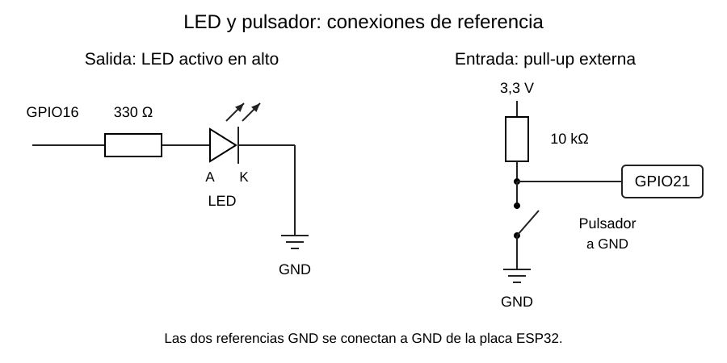

# Entradas y salidas digitales

[Índice de la semana](README.md) · [Siguiente: pulsadores](06_Pulsadores_Antirrebote.md)

## Configurar, escribir y leer

`pinMode(pin, OUTPUT)` habilita el uso como salida. `digitalWrite()` establece `HIGH` o `LOW`. En modo entrada, `digitalRead()` obtiene el nivel lógico. Una entrada digital no devuelve el voltaje exacto: clasifica la señal según umbrales.

| Modo | Uso |
|---|---|
| `INPUT` | Entrada sin resistencia interna de polarización |
| `INPUT_PULLUP` | Entrada con resistencia hacia 3,3 V, en pines compatibles |
| `INPUT_PULLDOWN` | Entrada con resistencia hacia GND, en pines compatibles |
| `OUTPUT` | Salida digital |

La tensión real de salida depende de alimentación y carga. Un GPIO entrega señales y corrientes limitadas; para cargas grandes se utiliza un transistor, controlador o interfaz de potencia.

## Conexión de un LED

Para encendido activo en alto: **GPIO16 → resistencia → ánodo del LED → cátodo → GND**. La resistencia puede ubicarse al otro lado del LED si sigue en serie.



La segunda mitad del esquema usa una pull-up externa de 10 kΩ. Si se usa la interna de GPIO21, se omite esa resistencia externa y se configura `INPUT_PULLUP`. Las tierras deben estar conectadas a la referencia GND de la placa.

## Cálculo de resistencia

La caída directa $V_f$ del LED depende del dispositivo y de la corriente. El modelo de cálculo es:

$$
R=\frac{V_{GPIO}-V_f}{I},\qquad I=\frac{V_{GPIO}-V_f}{R}.
$$

**Datos del material:** $V_{GPIO}=3{,}3\,\mathrm{V}$, $V_f\approx2{,}0\,\mathrm{V}$ para un LED rojo y $R=330\,\Omega$.

**Sustitución:** $I=(3{,}3-2{,}0)/330=0{,}003939\,\mathrm{A}$.

**Resultado:** aproximadamente **3,94 mA**. La potencia calculada de la resistencia es $I^2R\approx0{,}00512\,\mathrm{W}$. Son estimaciones de diseño; no sustituyen los límites de corriente del GPIO ni una medición del LED real.

Las fuentes mencionan LED azules o blancos con menor margen a 3,3 V. No significa que nunca enciendan: su mayor caída directa puede reducir la corriente disponible y el brillo.

## Ejemplo: el LED refleja el botón

**Sketch independiente para ESP32 clásico con Arduino 3.x**, LED externo en GPIO16 y botón entre GPIO21 y GND:

```cpp
#include <Arduino.h>

constexpr uint8_t LED = 16;
constexpr uint8_t BOTON = 21;
void setup() {
  pinMode(LED, OUTPUT);
  digitalWrite(LED, LOW);
  pinMode(BOTON, INPUT_PULLUP);
}
void loop() {
  bool pulsado = digitalRead(BOTON) == LOW;
  digitalWrite(LED, pulsado ? HIGH : LOW);
}
```

Este ejemplo responde al **nivel** del botón. No cuenta pulsaciones y no filtra el rebote. Su utilidad es comprender la inversión de la lógica pull-up: al unir el pin con GND, la lectura es LOW.

## Pull-up y pull-down

Una resistencia de **pull-up** mantiene la entrada en alto cuando el interruptor está abierto; **pull-down** la mantiene en bajo. Si el interruptor cierra hacia GND con pull-up, se lee bajo al presionar. Si cierra hacia 3,3 V con pull-down, se lee alto.

En el ejemplo externo de 10 kΩ, al presionar circula aproximadamente $3{,}3/10\,000=0{,}33\,\mathrm{mA}$ por la resistencia. Una entrada sin nivel definido es sensible al ruido. Los GPIO34–39 del ESP32 clásico requieren polarización externa cuando el circuito no define por sí mismo la tensión.

**Base de clase:** R, pp. 11 y 13–14; K05–K06; I21, pp. 3–4; I22, p. 5. **Verificación adicional:** D3 y D6. Véase [Fuentes](../FUENTES.md).
