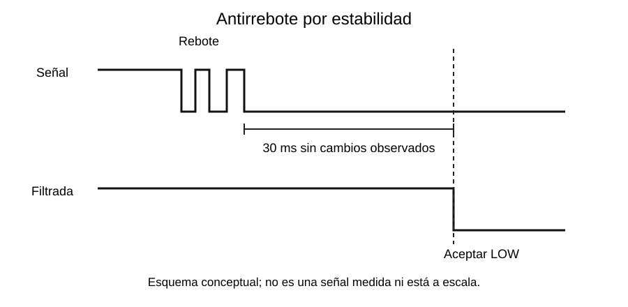

# Pulsadores y antirrebote por software

[Índice de la semana](README.md) · [Siguiente semana: temporizadores](../Semana_03_Temporizadores/README.md)

## Una pulsación puede generar varios cambios

Un pulsador mecánico no conecta de forma perfectamente instantánea. Sus contactos pueden abrir y cerrar varias veces antes de estabilizarse. Ese **rebote** produce varios flancos eléctricos a partir de una sola acción física.



La figura es conceptual, sin escala de medición. El tiempo de 30 ms procede del ejemplo de clase y debe elegirse para el pulsador y los requisitos de la aplicación. No es una constante física universal.

## Nivel, flanco y estado estable

Si el botón con pull-up permanece presionado, `digitalRead()` devuelve LOW en muchas vueltas. Incrementar un contador cada vez que LOW aparece cuenta **vueltas del programa**, no pulsaciones.

Un **flanco** es una transición. Para contar una pulsación se acepta primero un estado estable y luego se detecta **HIGH → LOW**. La liberación LOW → HIGH también se filtra, pero no incrementa el contador de pulsaciones.

## Algoritmo de estabilidad con millis()

Se guarda la lectura más reciente y el instante en que cambió. Cada nuevo cambio reinicia la espera. Solo después de 30 ms sin cambios observados se acepta la lectura como nuevo estado estable.

**Sketch independiente, ESP32 clásico con Arduino 3.x:**

```cpp
#include <Arduino.h>

constexpr uint8_t BOTON = 21;
constexpr uint32_t FILTRO_MS = 30;
bool lecturaAnterior = HIGH;
bool estable = HIGH;
uint32_t cambioEn = 0;
uint32_t pulsaciones = 0;

void setup() {
  Serial.begin(115200);
  pinMode(BOTON, INPUT_PULLUP);
  lecturaAnterior = digitalRead(BOTON);
  estable = lecturaAnterior; // no cuenta el botón ya pulsado al arrancar
  cambioEn = millis();
}

void loop() {
  uint32_t ahora = millis();
  bool lectura = digitalRead(BOTON);
  if (lectura != lecturaAnterior) {
    lecturaAnterior = lectura;
    cambioEn = ahora;
  }
  if (static_cast<uint32_t>(ahora - cambioEn) >= FILTRO_MS &&
      lectura != estable) {
    estable = lectura;
    if (estable == LOW) {
      ++pulsaciones;
      Serial.println(pulsaciones);
    }
  }
}
```

Todas las variables de este ejemplo se usan en `setup()`/`loop()`, sin ISR. **No necesitan `volatile` por el hecho de almacenar la lectura de un botón**.

## Seguir el ejemplo en el tiempo

Supóngase que la última oscilación observada termina en $t=12\,\mathrm{ms}$ y deja la entrada en LOW. Si ya no cambia y se consulta suficientemente a menudo, el nuevo estado puede aceptarse desde $12+30=42\,\mathrm{ms}$. En ese momento se incrementa una sola vez. Mantener LOW no genera nuevas transiciones estables.

Esta es una validación basada en **muestras del superlazo**. Si `loop()` contiene una espera larga, puede pasar por alto cambios entre lecturas y la respuesta se retrasa. Se evita `delay(200)` como sustituto general del filtro porque detiene otras comprobaciones de la tarea.

## Dos filtros diferentes

| Método | Qué acepta | Limitación |
|---|---|---|
| Estabilidad observada, 30 ms | Nivel que no ha cambiado durante la ventana | Requiere sondeo frecuente |
| Tiempo muerto, por ejemplo 50 ms | Primer evento y rechazo de los cercanos | Puede aceptar un ruido inicial; no demuestra estabilidad |

El segundo aparece en las interrupciones de la semana 4. No se deben describir como si fueran el mismo algoritmo.

**Base de clase:** R, p. 14; K06; I22, pp. 4–6. El código se reescribe con inicialización explícita y resta sin signo. Véase [Fuentes](../FUENTES.md).
