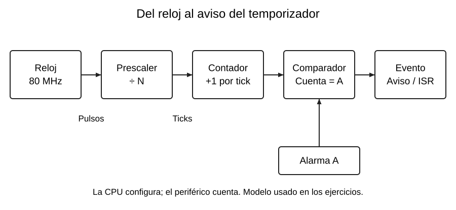

# Qué es un temporizador de hardware

[Índice de la semana](README.md) · [Siguiente: frecuencia y prescaler](02_Frecuencia_Prescaler.md)

## Contar pulsos para medir tiempo

Un **temporizador**, o timer, es un periférico con un contador que avanza a partir de un reloj. Cada pulso de conteo se llama **tick**. Si se conoce cuánto dura un tick, la cantidad acumulada se puede convertir en tiempo.

La CPU configura el reloj, la división, el sentido de conteo y la alarma. Después el hardware incrementa o decrementa el contador sin ejecutar una instrucción de CPU por cada tick. La CPU puede atender otras tareas hasta consultar el contador o recibir una interrupción.

En el esquema, el prescaler divide la frecuencia y el comparador detecta el valor de alarma. El registro de alarma guarda un objetivo; el contador guarda el valor que está cambiando.

## No es lo mismo que una variable

`contador++` dentro de `loop()` avanza según cuánto trabajo tarde el programa. Si se imprime por serie o cambia una condición, cambia la rapidez del conteo. Un contador de hardware sigue su fuente de reloj, aunque la tarea principal esté ocupada, mientras el periférico permanezca habilitado y con reloj.

El temporizador también puede detenerse, leerse o ponerse en un valor. Estas acciones se realizan mediante registros o una API. En esta unidad se utiliza la API de Arduino-ESP32 para configurarlo.

## delay(), millis() y timer

| Recurso | Cómo se usa | Efecto sobre la tarea principal |
|---|---|---|
| `delay(1000)` | La tarea espera el intervalo | No avanza el código siguiente de esa tarea durante la espera |
| `millis()` | El programa consulta el tiempo transcurrido | Puede seguir haciendo otras comprobaciones |
| Timer de hardware | Cuenta y genera una alarma configurada | Puede notificar por interrupción sin una consulta por cada tick |

`millis()` también se apoya en mecanismos temporales del entorno; no es un reloj creado por el bucle. La diferencia es cómo organiza el programa la espera y la atención del evento.

**Precisión respecto a I31:** `delay()` en ESP32 no detiene todo el sistema: puede ceder ejecución a otras tareas. Asimismo, que la alarma se produzca en hardware no garantiza que el código de la ISR empiece con latencia cero. Puede haber interrupciones enmascaradas o de mayor prioridad.

## Caso práctico

Se necesita muestrear aproximadamente cada 250 ms mientras el programa revisa entradas. Con `delay(250)` el superlazo deja de revisarlas durante la espera. Con `millis()` puede consultar si ya pasó el intervalo. Con un timer, una alarma puede dejar un aviso pendiente y `loop()` lo procesa después.

El instante de la alarma y el instante del procesamiento no son iguales. Una bandera avisa de que hay trabajo, pero no conserva automáticamente cada período transcurrido; para contar eventos se utiliza otro patrón.

## Cuántos temporizadores hay

El **ESP32 original** tiene cuatro temporizadores generales, organizados en dos grupos de dos, con contadores de 64 bits y prescaler. No se cuentan aquí otros recursos de tiempo del sistema. El ATmega328P dispone de tres timers, dos de ocho bits y uno de dieciséis.

**Base de clase:** R, pp. 15 y 17; K07; I31, pp. 1–3; I32, pp. 2–4; fotografía I-F08. **Verificación adicional:** D5 y D11. Véase [Fuentes](../FUENTES.md).
