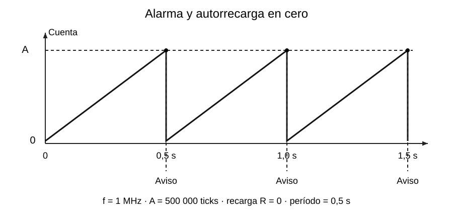

# Alarmas, autorrecarga y desbordamiento

[Índice de la semana](README.md) · [Siguiente: configuración e ISR](04_Interrupciones_Timer.md)

## Alarma: comparar con un objetivo

El registro de **alarma** contiene un valor $A$. Al alcanzarlo, el periférico produce el evento configurado. Para conteo ascendente desde cero, con frecuencia $f_{tick}$ y $A>0$:

$$
t_{alarma}=\frac{A}{f_{tick}}=A\Delta t.
$$

Con $f_{tick}=1\,\mathrm{MHz}$ y $A=500\,000$, el evento llega tras $0{,}5\,\mathrm{s}$. Si se empieza en otro valor, debe utilizarse la **distancia de conteo** hasta la alarma.

## Una vez o repetidamente

Sin autorrecarga se puede generar un aviso de una sola vez; el detalle de rearmado depende del periférico y la API. Con **autorrecarga**, el hardware vuelve al valor de recarga $R$ y repite el recorrido hasta $A$.

La figura representa $R=0$. En ese caso el período es $A/f_{tick}$ y la frecuencia de avisos es:

$$
f_{aviso}=\frac{1}{t_{alarma}}=\frac{f_{tick}}{A}.
$$

**Ampliación técnica, D11:** si el conteo ascendente se recarga en $R<A$, el intervalo periódico es $(A-R)/f_{tick}$. El primer intervalo depende además del valor inicial del contador. No se resta uno por costumbre: estas fórmulas expresan ticks transcurridos; los modos de comparación de otros temporizadores pueden tener convenciones distintas.

## Desbordamiento

Un contador sin signo de $n$ bits tiene valores de 0 a $2^n-1$. Si continúa incrementándose desde el máximo, vuelve a cero. Desde cero, el recorrido completo necesita $2^n$ ticks:

$$
t_{desbordamiento}=\frac{2^n}{f_{tick}}.
$$

| Ancho | Máximo | Tiempo hasta retornar a cero, a 1 MHz |
|---|---|---|
| 8 bits | 255 | 256 µs = 0,256 ms |
| 16 bits | 65 535 | 65 536 µs = 65,536 ms |
| 64 bits | 18 446 744 073 709 551 615 | Aproximadamente 584 542 años de 365,25 días |

La tabla utiliza la **misma frecuencia hipotética** para comparar anchos; no afirma que un timer AVR se haya configurado así en una práctica. Para Timer1 de 16 bits con reloj de 16 MHz sin divisor, el retorno sería $65\,536/16\,000\,000=4{,}096\,\mathrm{ms}$.

## Comparación importante

| Pregunta | Alarma con autorrecarga | Desbordamiento |
|---|---|---|
| ¿Qué valor lo provoca? | Objetivo programado | Límite del ancho del contador |
| ¿Por qué regresa? | Acción de recarga configurada | Aritmética del contador al superar el máximo |
| ¿Son el mismo evento? | No | No |

Alcanzar una alarma no implica que se acabaron los bits. Y un desbordamiento no implica por sí solo que se ejecutó una ISR: el evento y su interrupción deben estar soportados y habilitados.

## Particularidad del cuarto argumento de timerAlarm()

En el ejemplo 3.x `timerAlarm(timer, 500000, true, 0)`, la recarga empleada es cero. **Discrepancia de documentación:** la página Arduino consultada describe `reload_count` como número de recargas; el código oficial de los tags **3.0.7 y 3.3.0** lo pasa directamente al campo GPTimer `reload_count`, que es el **valor cargado en el contador**. Aquí se sigue la implementación comprobada. No se usa ese cuarto argumento para prometer «exactamente k repeticiones». Véanse D5, D11 y D12 en [Fuentes](../FUENTES.md).

**Base de clase:** R, pp. 17 y 20; K07; I32, pp. 1–2. Los valores exactos de la tabla se recalcularon para este cuaderno.
