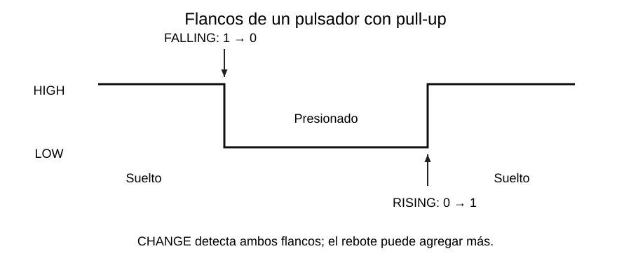

# Interrupciones GPIO y flancos

[Índice de la semana](README.md) · [Siguiente: ISR e IRAM](03_ISR_IRAM_Volatile.md)

## Nivel y flanco

Un **nivel** es un estado que permanece: alto o bajo. Un **flanco** es el cambio entre niveles. Para un botón entre GPIO21 y GND con pull-up, el reposo es HIGH y la presión lo lleva a LOW.



| Modo | Cambio eléctrico | Botón con pull-up, sin rebote |
|---|---|---|
| `FALLING` | 1 → 0 | Presionar |
| `RISING` | 0 → 1 | Soltar |
| `CHANGE` | Cualquiera de los dos | Presionar y soltar |

Con pull-down y botón hacia 3,3 V se invierte la relación física: presionar genera RISING. El modo describe la **señal**, no el nombre de la acción.

CHANGE produce dos transiciones por un ciclo ideal de presionar y soltar. Con rebote puede producir más; no equivale a «dos ISR garantizadas por pulsación».

## Registrar el manejador

La llamada del curso es:

```cpp
// En setup(), después de configurar BOTON:
// attachInterrupt(digitalPinToInterrupt(BOTON), alBoton, FALLING);
```

El primer argumento identifica el pin, el segundo es la función que se registra y el tercero selecciona el evento. Se escribe `alBoton` sin paréntesis porque se entrega la función; `alBoton()` intentaría ejecutarla en ese instante.

`digitalPinToInterrupt()` expresa la conversión recomendada en la interfaz Arduino. En el core ESP32 se trabaja con la identificación del GPIO, sin usar la numeración física del terminal de la placa.

**Fragmento de inicialización para ESP32**, suponiendo un callback `alBoton` ya definido:

```cpp
void configurarBoton() {
  pinMode(21, INPUT_PULLUP);
  attachInterrupt(digitalPinToInterrupt(21), alBoton, FALLING);
}
```

`configurarBoton()` se invoca desde `setup()`, una vez durante la preparación. El [ejemplo de bandera](04_Banderas_Eventos.md) incluye la definición del callback y todo el contexto. `detachInterrupt(digitalPinToInterrupt(21))` retira la asociación cuando la aplicación lo necesita; no se llama en cada vuelta sin motivo.

## Qué GPIO utilizar

Para los ejemplos se mantiene **GPIO21**. GPIO34–39 son entradas válidas para ciertos usos, pero no tienen resistencias internas: se necesita una pull-up externa si se conecta un botón a GND. GPIO6–11 se reservan para Flash en el módulo de referencia; los de strapping requieren revisar el arranque.

En GPIO34 o GPIO35, un circuito típico es **3,3 V → 10 kΩ → nodo GPIO**, con pulsador desde ese nodo a GND. El modo es `INPUT` y la resistencia es externa. Nunca se usa una pull-up a 5 V para estas entradas.

**Precisión técnica, D3:** las interrupciones de GPIO36 y GPIO39 presentan una restricción al combinar ciertos usos de ADC o Wi-Fi/Bluetooth con sueño habilitado. No se generaliza «cualquier pin de entrada sirve sin condiciones». Revisar también qué terminales expone el módulo.

## Errores de configuración

Confundir GPIO21 con «pin físico 21» conecta el circuito en otro lugar. Registrar la interrupción antes de preparar una entrada flotante puede producir avisos indeseados. Elegir FALLING para un botón con pull-down atiende la liberación, no la presión. Finalmente, configurar la interrupción no elimina el rebote mecánico.

**Base de clase:** R, pp. 18–19; K08; I41, pp. 3–4. **Verificación adicional:** D3 y D6. Véase [Fuentes](../FUENTES.md).
