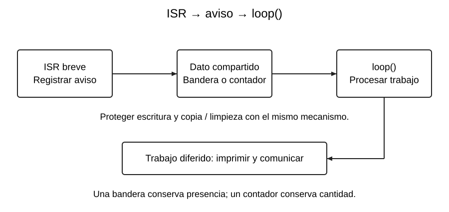

# Banderas y contadores de eventos

[Índice de la semana](README.md) · [Siguiente: antirrebote](05_Antirrebote_Interrupciones.md)

## Separar aviso y trabajo

El **patrón bandera** divide la reacción en dos partes: la ISR marca que hay un evento pendiente y `loop()` realiza la acción. Así se mantiene breve la atención de la interrupción.



La bandera representa «ha ocurrido al menos un evento desde la última atención». No contiene el momento exacto ni la cantidad.

## Ejemplo de bandera con copia y limpieza protegidas

**Sketch independiente, ESP32 clásico con Arduino-ESP32 3.x**, pulsador de GPIO21 a GND. Este ejemplo ilustra comunicación entre contextos; **todavía no incluye antirrebote**.

```cpp
#include <Arduino.h>

constexpr uint8_t BOTON = 21;
portMUX_TYPE mux = portMUX_INITIALIZER_UNLOCKED;
volatile bool pendiente = false;

void IRAM_ATTR alBoton() {
  portENTER_CRITICAL_ISR(&mux);
  pendiente = true;
  portEXIT_CRITICAL_ISR(&mux);
}

void setup() {
  Serial.begin(115200);
  pinMode(BOTON, INPUT_PULLUP);
  attachInterrupt(digitalPinToInterrupt(BOTON), alBoton, FALLING);
}

void loop() {
  portENTER_CRITICAL(&mux);
  bool aviso = pendiente;
  pendiente = false;
  portEXIT_CRITICAL(&mux);
  if (aviso) {
    Serial.println("Hay un evento pendiente");
  }
}
```

La misma variable `mux` protege el acceso en ambos contextos. Copiar y limpiar forman una pequeña transacción: una ISR que llegue después dejará la bandera marcada para la siguiente vuelta. La impresión se realiza **después** de salir de la sección crítica.

**Ampliación técnica, D8:** en ESP32 con varios núcleos, `noInterrupts()` afecta al núcleo local y no basta como protección general frente a otro núcleo. Se emplea el mecanismo del entorno con spinlock; aquí basta entender que ambos contextos deben usar la misma protección, sin desarrollar programación de tareas.

## Qué se pierde con un bool

Si ocurren cuatro ISR antes de leer la bandera, las cuatro escriben `true`. Cuando `loop()` copia, obtiene un único `true`. La protección evita perder una actualización por una carrera de copia/limpieza, pero **no convierte una bandera en una cola de cuatro eventos**.

| Necesidad | Representación |
|---|---|
| Saber si hay trabajo pendiente | Bandera booleana |
| Saber cuántos eventos se acumularon | Contador |
| Conservar valor u orden de cada evento | Cola o búfer con capacidad definida |

## Variante con contador

El siguiente **fragmento ESP32** sustituye el almacenamiento y la ISR del ejemplo anterior; se registra `alPulso` en lugar de `alBoton`. No se añade al sketch sin retirar las declaraciones sustituidas.

```cpp
portMUX_TYPE muxPulsos = portMUX_INITIALIZER_UNLOCKED;
volatile uint32_t pulsos = 0;

void IRAM_ATTR alPulso() {
  portENTER_CRITICAL_ISR(&muxPulsos);
  pulsos = pulsos + 1U;
  portEXIT_CRITICAL_ISR(&muxPulsos);
}

uint32_t tomarPulsos() {
  portENTER_CRITICAL(&muxPulsos);
  uint32_t cantidad = pulsos;
  pulsos = 0;
  portEXIT_CRITICAL(&muxPulsos);
  return cantidad;
}
```

`loop()` llama `tomarPulsos()` y procesa la cantidad fuera de la sección crítica. Si cuatro ISR terminan antes de la copia, devuelve 4. Son **interrupciones registradas**, no necesariamente cuatro pulsaciones físicas: el rebote también suma.

Un contador sin signo de 32 bits retorna a cero tras $2^{32}$ incrementos sin vaciarse. Debe atenderse antes de exceder su capacidad. Tampoco puede contar flancos que el periférico no detectó o que no llegaron a convertirse en atenciones separadas. Para frecuencias elevadas conviene estudiar un contador de pulsos de hardware.

## Pregunta de control

**Si el botón rebota y loop tarda dos segundos, ¿se imprimirán más de diez mensajes después de diez pulsaciones?** No se puede asegurar. Puede haber muchas ISR, pero una bandera las agrupa y el trabajo lento limita cuántas se atienden. Hay que diferenciar flancos, ISR y mensajes. Esa distinción corrige la conclusión demasiado general del control de aprendizaje en I43, p. 4.

**Base de clase:** R, pp. 17 y 19; K08; I32, p. 5; I43, pp. 1–4. **Complemento técnico:** D8 para protección compartida. Véase [Fuentes](../FUENTES.md).
